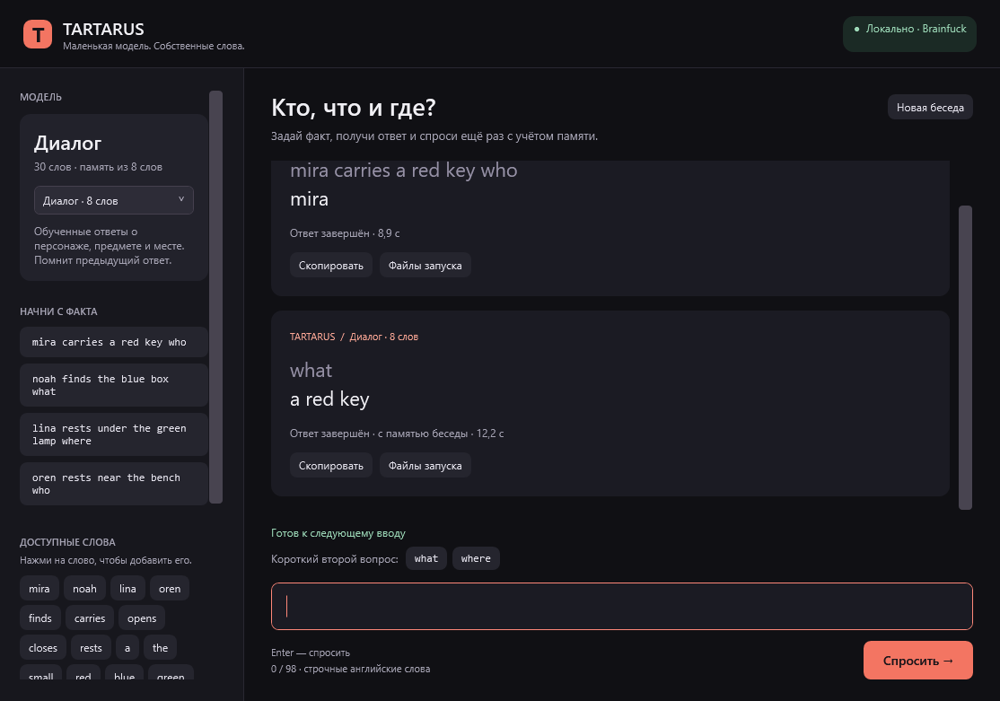

# Tartarus

**Маленькая модель на рукописном Brainfuck: вопросы, ответы и память предыдущей реплики.**

Первый запускаемый релиз **v0.1.0**,14 октября2026. На GitHub раньше было
только описание46-го этапа. Теперь доступны обученная модель, окно Windows,
CLI и полный комплект для повторного обучения и оценки.

[Скачать релиз](https://github.com/smoKlegIoNiTOOK40/bf-tartarus-torture-machine/releases/tag/v0.1.0)
· [English README](README.md) · [Подробные результаты](docs/RESULTS.md)



Скачай **tartarus-copy8-windows-v0.1.0.zip**, распакуй целиком и открой
**Tartarus.exe**. Сеть, Python, ML-пакеты и сервер модели не нужны.
Окно на русском, ввод — строчные английские слова.

В режиме **Диалог · 8 слов** выбери первый пример и нажми **Спросить**:

```text
mira carries a red key who
→ mira

what
→ a red key
```

Второй вопрос использует настоящий предыдущий ответ. Для места попробуй
`oren rests near the bench who`, затем `where` → `near the bench`.
**Новая беседа** сбрасывает память. Старые Who v1 и Word80 сохранены в списке.

Модель занимает **4902байта**, словарь — **30 слов**, память — **8 слов**.
На закреплённом синтетическом корпусе:24/24 validation,48/48 test,
включая8/8 и16/16 связанных эпизодов с двумя правильными ответами и EOS.
Автор видел сырые отложенные данные; это не слепой языковой benchmark.
Повторное BF-обучение воспроизвело все четыре файла модели побайтно.

Пока поддерживается маленький язык фактов с who/what/where в конце и короткие
связанные вопросы. Произвольная речь и длинные разговоры не подтверждены.
Большая часть Transformer-ядра фиксирована; обучаются дискретные embeddings
и таблицы действий копирования. Это исследовательский прототип.

В релизе три ZIP: окно, минимальный CLI и полные исходники обучения.
Для повторного обучения нужен PowerShell7; инструкция — docs/REPRODUCE.md.
В Git лежат исходники текущего runtime, модель, GUI и малые результаты;
большие исследовательские зависимости — в отдельном ZIP.

Все вычисления модели, обучение, выбор ответа и независимая численная проверка
выполняются BF. Host обслуживает байты, файлы, процессы и окно. Проект создан
[smoKlegIoNiTOOK40](https://github.com/smoKlegIoNiTOOK40) вместе с OpenAI Codex;
участие AI раскрыто. Обычный интерпретатор qdb — Daniel B. Cristofani,
его исходный readme и атрибуция приложены.
